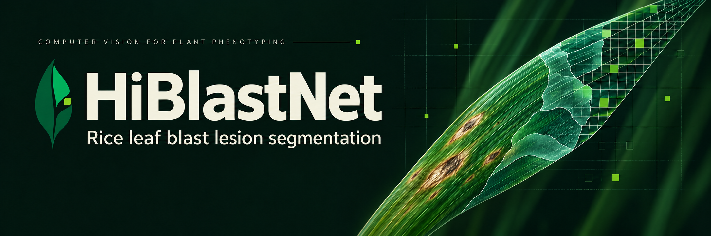

<p align="center"><strong>English</strong> &nbsp;·&nbsp; <a href="README.zh-CN.md">简体中文</a></p>

<p align="center">
  
</p>

# HiBlastNet

HiBlastNet segments small rice blast lesions by processing each leaf in overlapping windows at its calibrated resolution. It distinguishes healthy tissue, susceptible-type lesions and resistant-type lesions. For photographs taken on a reference board, the command-line tools report lesion counts, area fractions and lengths for each leaf and assign a severity grade from 0 to 9.

## Install

Install Git and Miniconda, then run:

```bash
git clone https://github.com/Ethan-Zhu-code/HiBlastNet.git
cd HiBlastNet
conda create -n hiblastnet python=3.11 -y
conda activate hiblastnet
```

Install PyTorch and torchvision with the command for your hardware from the [PyTorch installation page](https://pytorch.org/get-started/locally/), then install the remaining packages:

```bash
python -m pip install -r requirements.txt
```

The paper experiments used PyTorch 2.5.1 with CUDA 12.1. Training needs an NVIDIA GPU. Evaluation and prediction also run on CPU, slowly.

## Downloads

| Resource | Contents | OneDrive | Baidu Netdisk · code |
| --- | --- | --- | --- |
| BlastLeaf dataset | 707 rice leaf crops from 283 photographs, with pixel-level masks | [OneDrive](https://1drv.ms/u/c/1495c176035c0989/IQCrwwXhApP_TpZNFzTIXQelAe2YA5BwKQ68frvLGekOpbQ?e=dtETWr) | [Baidu Netdisk](https://pan.baidu.com/s/1K6AEge89TWjPSs5MAovVrg?pwd=p1p6) · `p1p6` |
| Original board photographs | 30 test-set JPEGs (419 MB) covering 72 annotated leaves | [OneDrive](https://1drv.ms/u/c/1495c176035c0989/IQBtNABm1JC3SIWQSa1nlXPRAYTeY_4OhdFh1d5rHNjfLeA?e=g9yzBJ) | [Baidu Netdisk](https://pan.baidu.com/s/1EUgH1kOioeeU1JFz02Q_cw?pwd=ek4a) · `ek4a` |
| Model weights | 12 checkpoints for four configurations, each trained with three seeds | [OneDrive](https://1drv.ms/u/c/1495c176035c0989/IQC_DSvX2FfxRrrIhwz_O7L-AfOekbesJ90LgyT1dyQLT-o?e=HRmyBq) | [Baidu Netdisk](https://pan.baidu.com/s/1EQbfUBzC3oSwfghtue5rhA?pwd=9zgt) · `9zgt` |

Extract the dataset to `data/blastleaf/` and place the `.pth` files in `weights/`. To photograph new samples, use the [printable A4 reference board](.github/media/reference-board-a4.svg).

## Usage

[Training](docs/usage.md#train) · [Evaluation](docs/usage.md#evaluate) · [Single-leaf prediction](docs/usage.md#predict) · [Grading a board photograph](docs/usage.md#grade-a-raw-photo) · [Methods and configurations](docs/usage.md#methods-and-configurations)

## Citation

The manuscript *HiBlastNet: a scale-preserving segmentation network for small rice blast lesions in quantitative measurement and severity grading* is in preparation. Please cite [this repository](https://github.com/Ethan-Zhu-code/HiBlastNet) in the meantime.

## License

| Part | License |
| --- | --- |
| Code in this repository | [MIT](LICENSE) |
| Third-party code | Its original license; see [THIRD_PARTY_NOTICES.md](THIRD_PARTY_NOTICES.md) and [licenses/](licenses/) |
| BlastLeaf dataset | [CC BY 4.0](https://creativecommons.org/licenses/by/4.0/) |
| Trained weights | [CC BY 4.0](https://creativecommons.org/licenses/by/4.0/) |

The SegFormer files (`blastseg/models/segformer*.py`) are under the NVIDIA Source Code License and may be used only for non-commercial research or evaluation. Remove the SegFormer comparison model if you need to use the code commercially.
