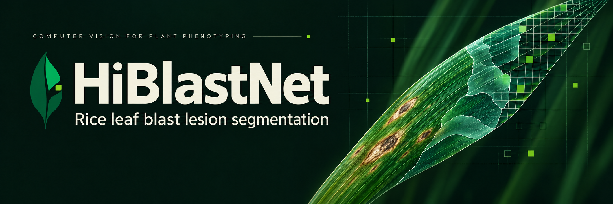

<p align="center"><a href="README.md">English</a> &nbsp;·&nbsp; <strong>简体中文</strong></p>

<p align="center">
  
</p>

# HiBlastNet

HiBlastNet 用于分割水稻叶瘟的感病型和抗病型病斑。模型在 60 像素/mm 的标定尺度下分窗处理整片叶子，保留整叶缩放时容易丢失的小病斑。仓库提供模型训练、评估和命令行工具，可从标定板照片提取单叶、测量病斑并按 0–9 级评级。桌面应用单独维护。

## 安装

安装 Git 和 Miniconda 后，执行：

```bash
git clone https://github.com/Ethan-Zhu-code/HiBlastNet.git
cd HiBlastNet
conda create -n hiblastnet python=3.11 -y
conda activate hiblastnet
```

根据硬件选择 [PyTorch 官网](https://pytorch.org/get-started/locally/) 提供的命令安装 PyTorch 和 torchvision，再安装其余依赖：

```bash
python -m pip install -r requirements.txt
```

论文实验使用 PyTorch 2.5.1 和 CUDA 12.1。训练需要 NVIDIA GPU；评估和预测也可在 CPU 上运行，但速度较慢。

## 下载

| 资源 | 内容 | OneDrive | 百度网盘及提取码 |
| --- | --- | --- | --- |
| BlastLeaf 数据集 | 283 张照片中的 707 片叶，含 71,255 个标注病斑连通域 | [OneDrive](https://1drv.ms/u/c/1495c176035c0989/IQCrwwXhApP_TpZNFzTIXQelAe2YA5BwKQ68frvLGekOpbQ?e=dtETWr) | [百度网盘](https://pan.baidu.com/s/1K6AEge89TWjPSs5MAovVrg?pwd=p1p6) · `p1p6` |
| 标定板原图示例 | 30 张测试集原图，对应 72 片已标注叶片（419 MB） | [OneDrive](https://1drv.ms/u/c/1495c176035c0989/IQBtNABm1JC3SIWQSa1nlXPRAYTeY_4OhdFh1d5rHNjfLeA?e=g9yzBJ) | [百度网盘](https://pan.baidu.com/s/1EUgH1kOioeeU1JFz02Q_cw?pwd=ek4a) · `ek4a` |
| 模型权重 | 4 种模型配置，每种含 3 个随机种子，共 12 个权重文件 | [OneDrive](https://1drv.ms/u/c/1495c176035c0989/IQC_DSvX2FfxRrrIhwz_O7L-AfOekbesJ90LgyT1dyQLT-o?e=HRmyBq) | [百度网盘](https://pan.baidu.com/s/1EQbfUBzC3oSwfghtue5rhA?pwd=9zgt) · `9zgt` |

## 使用指南

[数据与权重准备](docs/usage.zh-CN.md#数据集) · [训练](docs/usage.zh-CN.md#训练) · [评估与复现](docs/usage.zh-CN.md#评估) · [单叶预测](docs/usage.zh-CN.md#单叶预测) · [标定板原图评级](docs/usage.zh-CN.md#原图评级)

## 引用

论文 *HiBlastNet: a scale-preserving segmentation network for small rice blast lesions in quantitative measurement and severity grading* 为 in preparation（准备中）。正式引用信息可用后会补充 BibTeX，现阶段可引用本仓库的网址。

## 许可证

| 内容 | 许可证 |
| --- | --- |
| 本仓库代码 | [MIT](LICENSE) |
| 第三方代码 | 沿用各自原许可证，见 [THIRD_PARTY_NOTICES.md](THIRD_PARTY_NOTICES.md) 和 [licenses/](licenses/) |
| BlastLeaf 数据集 | [CC BY 4.0](https://creativecommons.org/licenses/by/4.0/) |
| 预训练权重 | [CC BY 4.0](https://creativecommons.org/licenses/by/4.0/) |

SegFormer 文件（`blastseg/models/segformer*.py`）遵循 NVIDIA Source Code License，仅可用于非商业研究或评估。如需将代码用于商业用途，请移除 SegFormer 对比模型。
